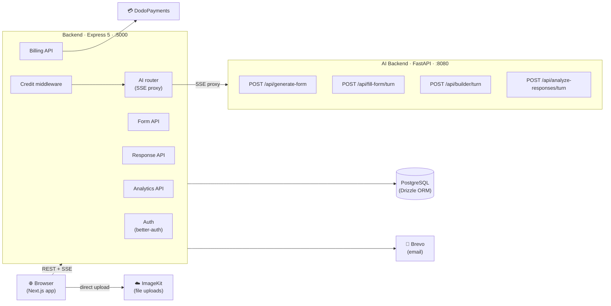
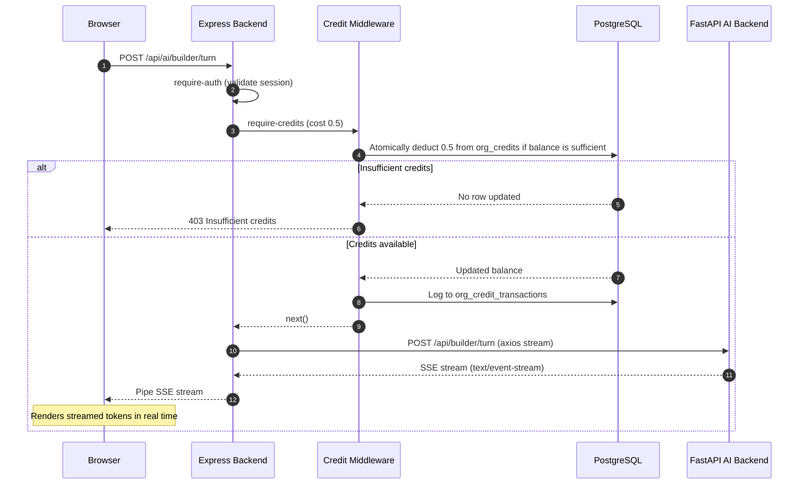
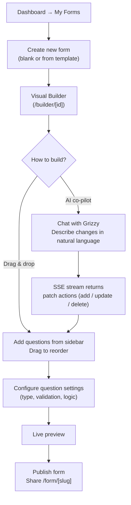
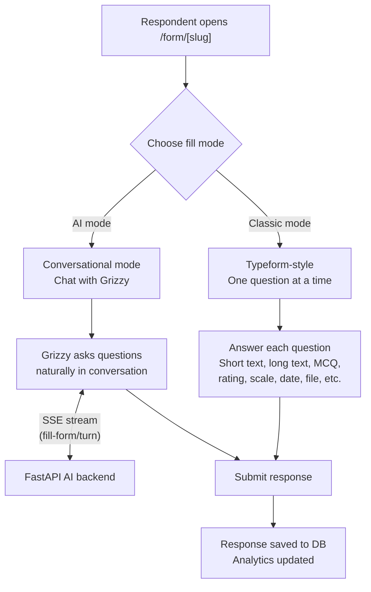
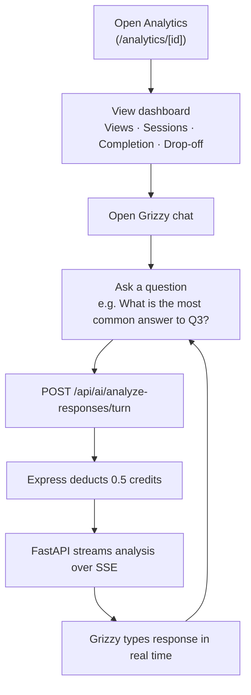
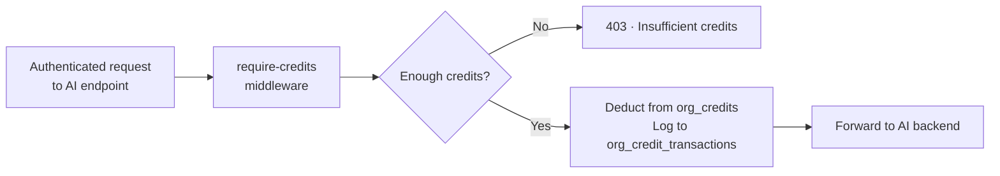

<div align="center">

# 🧩 Convia

**AI-powered form builder and intelligent data collection platform**

Build beautiful forms, collect responses, and let **Grizzy**, your AI co-pilot, help you build, fill, and analyze everything.

[](https://www.typescriptlang.org/)
[](https://nextjs.org/)
[](https://expressjs.com/)
[](https://www.python.org/)
[](https://fastapi.tiangolo.com/)
[](https://www.postgresql.org/)
[](LICENSE)
[](#contributing)

[Features](#features) · [Architecture](#architecture) · [Getting Started](#getting-started) · [API](#api-overview) · [Billing](#billing--credits) · [Contributing](#contributing)

</div>

---

## Table of Contents

- [Overview](#overview)
- [Features](#features)
- [Architecture](#architecture)
- [Tech Stack](#tech-stack)
- [Getting Started](#getting-started)
- [Environment Variables](#environment-variables)
- [User Flows](#user-flows)
- [Project Structure](#project-structure)
- [API Overview](#api-overview)
- [Billing & Credits](#billing--credits)
- [Contributing](#contributing)
- [License](#license)

---

## Overview

Convia is a full-stack, AI-native form platform. Teams can build forms with a visual drag-and-drop editor, or just by describing what they want in plain English.

Respondents can complete a form in a classic Typeform-style flow, or through a natural conversation with Grizzy, the built-in AI assistant. Once responses come in, Grizzy can answer analytical questions about the data in real time, all streamed over Server-Sent Events (SSE).

---

## Features

| Category | Highlights |
|---|---|
| 🏗️ **Form Builder** | Drag-and-drop visual editor with live preview and multiple question types |
| 🤖 **Grizzy AI Co-pilot** | Chat-driven form builder, filler, and analytics assistant |
| ✨ **AI Form Generation** | Generate a full form from a plain-English description in seconds |
| 📋 **Dual Fill Modes** | Respondents choose between classic Typeform-style or AI conversational mode |
| 📊 **Analytics Dashboard** | Views, sessions, completion rates, and drop-off per question |
| 💬 **AI Analytics Chat** | Ask Grizzy natural-language questions about your response data |
| 🏢 **Multi-org Support** | Create and switch between multiple organizations |
| 🧾 **Templates Gallery** | Jumpstart with pre-built form templates |
| 📁 **File Uploads** | Image and file upload questions powered by ImageKit |
| 📤 **Response Export** | Export responses to Excel / CSV |
| 💳 **Credit-based Billing** | Subscription plans via DodoPayments with per-feature credit costs |
| 🔐 **Auth** | Email/password and Google OAuth, plus organization invitations |
| 📧 **Email Notifications** | Transactional emails via Brevo |
| ⚡ **Real-time Streaming** | All AI features stream over Server-Sent Events (SSE) |

---

## Architecture

Convia is a monorepo with three independent services that communicate over HTTP.

| Service | Directory | Stack | Default port |
|---|---|---|---|
| **Frontend** | `frontend/` | Next.js 16 | `3000` |
| **Backend** | `backend/` | Express 5 | `5000` |
| **AI Backend** | `ai-backend/` | FastAPI | `8080` |

The public form route (`/form/[slug]`) requires no authentication.



### Request flow for AI features

Authenticated AI endpoints pass through the session guard and the credit middleware before the request is proxied to FastAPI. If the organization has too few credits, the request is rejected before it reaches the AI backend.



---

## Tech Stack

<details open>
<summary><b>Frontend</b></summary>

| Tool | Purpose |
|---|---|
| Next.js 16 / React 19 | App framework & server components |
| TypeScript 5 | Type safety |
| Tailwind CSS 4 | Utility-first styling |
| shadcn/ui + Radix UI | Accessible component primitives |
| Motion (Framer) | Animations |
| Zustand + Immer | Client state management |
| TanStack Query | Server state / data fetching |
| React DnD | Drag-and-drop form builder |
| Recharts | Analytics charts |
| React Hook Form + Zod | Form validation |
| better-auth (client) | Authentication |
| ImageKit Next.js | File uploads |
| xlsx | Excel export |
| Sonner | Toast notifications |

</details>

<details>
<summary><b>Backend (Express)</b></summary>

| Tool | Purpose |
|---|---|
| Express 5 | HTTP server |
| TypeScript | Type safety |
| Drizzle ORM + drizzle-kit | ORM & migrations |
| PostgreSQL (`pg`) | Primary database |
| better-auth | Auth server (sessions, OAuth, orgs) |
| DodoPayments SDK | Subscription billing |
| @getbrevo/brevo | Transactional email |
| Axios | SSE proxy to AI backend |
| Zod | Request validation |

</details>

<details>
<summary><b>AI Backend (FastAPI)</b></summary>

| Tool | Purpose |
|---|---|
| Python 3.14+ | Runtime |
| FastAPI + Uvicorn | ASGI HTTP server |
| LangChain Core + Community | LLM orchestration |
| langchain-google-genai | Google Gemini model support |
| langchain-groq | Groq (Llama) model support |
| python-dotenv | Environment configuration |

</details>

---

## Getting Started

### Prerequisites

- **Node.js** ≥ 20
- **pnpm** ≥ 12.6 (frontend and backend use pnpm)
- **Python** ≥ 3.14 with `uv` or `pip`
- **PostgreSQL** ≥ 15, local or remote
- API keys for Google OAuth, ImageKit, DodoPayments, Brevo, and an LLM provider (Gemini or Groq)

### Installation

**1. Clone the repository**

```bash
git clone https://github.com/your-org/convia.git
cd convia
```

**2. Frontend** → [http://localhost:3000](http://localhost:3000)

```bash
cd frontend
pnpm install
cp .env.example .env     # fill in values (see Environment Variables)
pnpm dev
```

**3. Backend (Express)** → [http://localhost:5000](http://localhost:5000)

```bash
cd backend
pnpm install
cp .env.example .env     # fill in values
pnpm db:push             # push the Drizzle schema to your database
pnpm dev
```

**4. AI Backend (FastAPI)** → [http://localhost:8080](http://localhost:8080)

```bash
cd ai-backend
uv sync                  # or: pip install -e .
cp .env.example .env     # fill in values
uvicorn src.main:app --host 0.0.0.0 --port 8080 --reload
```

> [!TIP]
> Start the services in this order: **AI backend → Express backend → frontend**, so each service can reach its upstream dependency on boot.

---

## Environment Variables

> [!NOTE]
> ✅ = required, ⬜ = optional (a default is used).

<details>
<summary><b>Frontend</b> · <code>frontend/.env</code></summary>

| Variable | Required | Description |
|---|:---:|---|
| `BACKEND_URL` | ✅ | Express backend URL (server-side), e.g. `http://localhost:5000` |
| `NEXT_PUBLIC_BACKEND_URL` | ✅ | Express backend URL (client-side), e.g. `http://localhost:5000` |
| `NEXT_PUBLIC_IMAGEKIT_URL_ENDPOINT` | ✅ | ImageKit URL endpoint |
| `NEXT_PUBLIC_IMAGEKIT_PUBLIC_KEY` | ✅ | ImageKit public key |
| `IMAGEKIT_PRIVATE_KEY` | ✅ | ImageKit private key (server-side only) |

</details>

<details>
<summary><b>Backend</b> · <code>backend/.env</code></summary>

| Variable | Required | Description |
|---|:---:|---|
| `DATABASE_URL` | ✅ | PostgreSQL connection string |
| `BETTER_AUTH_SECRET` | ✅ | Random secret for session signing |
| `BETTER_AUTH_URL` | ✅ | Backend's public URL, e.g. `http://localhost:5000` |
| `GOOGLE_CLIENT_ID` | ✅ | Google OAuth client ID |
| `GOOGLE_CLIENT_SECRET` | ✅ | Google OAuth client secret |
| `CLIENT_URL` | ✅ | Frontend URL for CORS and redirects |
| `BREVO_API_KEY` | ✅ | Brevo (Sendinblue) API key |
| `BREVO_SENDER_EMAIL` | ⬜ | Sender email (default: `notifications@convia.app`) |
| `BREVO_SENDER_NAME` | ⬜ | Sender name (default: `Convia`) |
| `AI_BACKEND_URL` | ⬜ | FastAPI URL (default: `http://localhost:8080`) |
| `DODO_PAYMENTS_API_KEY` | ✅ | DodoPayments API key |
| `DODO_PAYMENTS_WEBHOOK_SECRET` | ✅ | DodoPayments webhook signing secret |
| `DODO_PRODUCT_BUILDER` | ✅ | DodoPayments product ID for the Builder plan |
| `DODO_PRODUCT_PRO` | ✅ | DodoPayments product ID for the Pro plan |
| `PORT` | ⬜ | Server port (default: `5000`) |

</details>

<details>
<summary><b>AI Backend</b> · <code>ai-backend/.env</code></summary>

| Variable | Required | Description |
|---|:---:|---|
| `BACKEND_URL` | ✅ | Express backend URL (for the CORS allowlist) |
| `GOOGLE_API_KEY` | ✅* | Google Gemini API key |
| `GROQ_API_KEY` | ✅* | Groq API key |

\* At least one LLM provider key is required, depending on `src/config/models.py`.

</details>

---

## User Flows

### Form Builder Flow



### Form Filling Flow



### AI Analytics Flow



---

## Project Structure

<details>
<summary>Expand full tree</summary>

```
convia/
├── frontend/                       # Next.js 16 application
│   ├── src/
│   │   ├── app/                    # App Router pages & layouts
│   │   │   ├── (auth)/             # Sign-in / Sign-up
│   │   │   ├── (dashboard)/        # Authenticated app pages
│   │   │   │   ├── home/           # Dashboard
│   │   │   │   ├── my-forms/       # Form management
│   │   │   │   ├── builder/[id]/   # Form builder
│   │   │   │   ├── analytics/[id]/
│   │   │   │   ├── responses/[id]/
│   │   │   │   ├── billing/        # Plans & payment
│   │   │   │   ├── templates/      # Template gallery
│   │   │   │   └── profile/
│   │   │   ├── form/[slug]/        # Public form filling (no auth)
│   │   │   └── page.tsx            # Landing page
│   │   ├── components/
│   │   │   ├── landing/            # Landing page sections
│   │   │   ├── builder/            # Visual form builder UI
│   │   │   ├── form-viewer/        # Form filling (Typeform + AI)
│   │   │   ├── analytics/          # Charts & Grizzy analytics
│   │   │   ├── billing/            # Pricing cards & billing UI
│   │   │   ├── responses/          # Response table & export
│   │   │   └── ui/                 # shadcn/ui base components
│   │   ├── lib/
│   │   │   ├── api/                # API clients (sse-reader, ai-fill, etc.)
│   │   │   ├── stores/             # Zustand stores (builder, chat, etc.)
│   │   │   └── utils.ts
│   │   └── hooks/                  # Custom React hooks
│   └── package.json
│
├── backend/                        # Express 5 API server
│   ├── src/
│   │   ├── modules/
│   │   │   ├── ai/                 # AI routes (fill, builder, analytics, generate)
│   │   │   ├── analytics/          # Form analytics tracking
│   │   │   ├── billing/            # DodoPayments + credit system
│   │   │   ├── form/               # Form CRUD
│   │   │   └── response/           # Response submission
│   │   ├── middlewares/
│   │   │   ├── require-auth.ts     # Session guard
│   │   │   ├── require-credits.ts  # Credit check & deduction
│   │   │   └── validate.ts         # Zod schema validation
│   │   ├── db/
│   │   │   └── schema/             # Drizzle ORM table definitions
│   │   ├── lib/
│   │   │   └── auth.ts             # better-auth server config
│   │   ├── utils/
│   │   │   └── pipe-sse-stream.ts  # Shared SSE proxy helper
│   │   └── config/
│   │       └── env.config.ts
│   └── package.json
│
└── ai-backend/                     # FastAPI AI service
    ├── src/
    │   ├── app.py                  # FastAPI factory + CORS + router mounts
    │   ├── main.py                 # Uvicorn entry point
    │   ├── config/
    │   │   └── models.py           # LLM provider configuration
    │   └── modules/
    │       ├── generate_form/      # Form generation from description
    │       ├── fill_form/          # AI form-filling turns
    │       ├── builder_chat/       # Grizzy builder co-pilot turns
    │       └── analyze_responses/  # Grizzy analytics turns
    └── pyproject.toml
```

</details>

---

## API Overview

All backend routes are prefixed with `/api`.

### Auth · `/api/auth/*`

Handled entirely by **better-auth**: email/password, Google OAuth, session management, and organization invitations.

### Forms · `/api/form`

| Method | Path | Auth | Description |
|---|---|:---:|---|
| `GET` | `/api/form` | ✅ | List the org's forms |
| `POST` | `/api/form` | ✅ | Create a new form |
| `GET` | `/api/form/:id` | ✅ | Get form by ID |
| `PATCH` | `/api/form/:id` | ✅ | Update form |
| `DELETE` | `/api/form/:id` | ✅ | Delete form |
| `GET` | `/api/form/slug/:slug` | ❌ | Get public form by slug |

### Responses · `/api/response`

| Method | Path | Auth | Description |
|---|---|:---:|---|
| `POST` | `/api/response` | ❌ | Submit a form response |
| `GET` | `/api/response/:formId` | ✅ | Get all responses for a form |

### Analytics · `/api/analytics`

| Method | Path | Auth | Description |
|---|---|:---:|---|
| `POST` | `/api/analytics/view` | ❌ | Record a form view |
| `POST` | `/api/analytics/session` | ❌ | Record session start |
| `GET` | `/api/analytics/:formId` | ✅ | Get analytics summary |

### AI · `/api/ai`

| Method | Path | Auth | Credits | Description |
|---|---|:---:|:---:|---|
| `POST` | `/api/ai/fill-form/turn` | ❌ | Free | AI-assisted form filling (SSE) |
| `POST` | `/api/ai/generate-form` | ✅ | 10 | Generate a form from a description |
| `GET` | `/api/ai/jobs/:jobId/status` | ✅ | n/a | Poll generation job status |
| `POST` | `/api/ai/analyze-responses/turn` | ✅ | 0.5 | Grizzy analytics Q&A (SSE) |
| `POST` | `/api/ai/builder/turn` | ✅ | 0.5 | Grizzy builder chat (SSE) |

### Billing · `/api/billing`

| Method | Path | Auth | Description |
|---|---|:---:|---|
| `GET` | `/api/billing/plan` | ✅ | Get the org's current plan & credits |
| `POST` | `/api/billing/checkout` | ✅ | Create a DodoPayments checkout session |
| `POST` | `/api/billing/webhook` | ❌ | DodoPayments webhook handler |

---

## Billing & Credits

Convia uses a **credit-based** system tied to subscription plans, managed per organization.

| Plan | Price | Credits / month | Orgs | AI Generate | Grizzy turns |
|---|---|---:|---:|---|---|
| **Free** | \$0 | 100 | 1 | 10 credits each | 0.5 credits each |
| **Builder** | \$12 / mo | 600 | 5 | 10 credits each | 0.5 credits each |
| **Pro** | \$29 / mo | 2,000 | Unlimited | 10 credits each | 0.5 credits each |

### How credits work



- Credits reset monthly on the billing-cycle date.
- Free-plan credits reset lazily, on the first API call after `cycleEnd`.
- Paid plans are managed via DodoPayments webhooks (`subscription.active`, `subscription.renewed`, etc.).
- The `org_credit_transactions` table provides a full audit trail of who used what, and when.

> [!IMPORTANT]
> Filling a form in AI mode (`/api/ai/fill-form/turn`) is free and unauthenticated, so respondents never spend the form owner's credits.

---

## Contributing

Contributions are welcome!

1. Fork the repository
2. Create a feature branch: `git checkout -b feat/your-feature`
3. Commit your changes: `git commit -m "feat: add your feature"`
4. Push the branch: `git push origin feat/your-feature`
5. Open a Pull Request

Please follow the existing code style (ESLint + Prettier for TypeScript, Ruff for Python) and make sure typechecks pass before submitting:

```bash
# Frontend typecheck
cd frontend && pnpm tsc --noEmit

# Backend typecheck
cd backend && ./node_modules/.bin/tsc --noEmit
```

---

## License

This project is licensed under the **ISC License**. See [LICENSE](LICENSE) for details.

---

<div align="center">

Built with ❤️ using Next.js, Express, FastAPI, and a lot of Grizzy magic.

</div>
